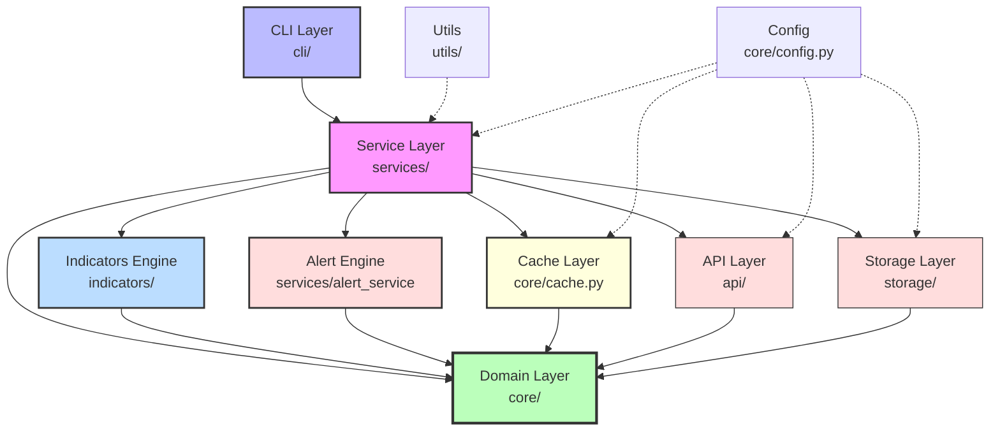

# 📈 Forex Tracker (CLI & Agent Base)

> **أداة سطر أوامر (CLI Tool) مفتوحة المصدر** مبنية وفق معمارية **Agile / Vertical Slice Architecture** لتحليل وتتبع أسواق العملات الأجنبية (Forex). تمثل الأساس المعماري لتطوير **Forex AI Agent** تفاعلي يعتمد على خوارزميات التعلم الآلي وقابلية التفسير (ML + LSTM + XAI).

<div align="center">


</div>

---

## 📑 جدول المحتويات

<details>
<summary>اضغط لعرض المحتويات</summary>

- [نظرة عامة](#-نظرة-عامة)
- [متطلبات التشغيل](#️-متطلبات-التشغيل)
- [التثبيت والإعداد](#-التثبيت-والإعداد)
- [الاستخدام وأوامر الـ CLI](#-الاستخدام-وأوامر-الـ-cli)
- [الاختبارات](#-تشغيل-اختبارات-الوحدة)
- [هيكل المشروع](#-هيكل-المشروع-الحالي)
- [المعمارية ومبادئ التصميم](#️-المعمارية-ومبادئ-التصميم)
- [خارطة الطريق](#️-خارطة-الطريق-roadmap)
- [المساهمة](#-المساهمة)
- [الترخيص](#-الترخيص)

</details>

---

## 🎯 نظرة عامة

**Forex Tracker** ليس مجرد أداة لجلب الأسعار — بل هو **أساس معماري صلب** لبناء وكيل ذكي (AI Agent) قادر على:

- 📊 تحليل الأسواق وتتبع الشموع السعرية بدقة مالية عالية.
- 🤖 استخدام نماذج التعلم الآلي للتنبؤ بالاتجاهات.
- 🔍 تقديم تفسيرات واضحة لقرارات النماذج (Explainable AI).

### ✨ المميزات الأساسية

| الميزة | الوصف |
| -------- | ------- |
| 🏗️ **Clean Architecture** | فصل تام بين الطبقات (Domain / Services / CLI / Storage) |
| 💰 **دقة مالية** | استخدام `Decimal` بدلاً من `float` لتجنب أخطاء التقريب |
| 🔒 **Immutable Objects** | حماية بيانات الشموع من التعديل العرضي |
| 🔌 **Adapter Pattern** | سهولة استبدال مزودي البيانات (TwelveData → أي مصدر آخر) |
| ⚡ **Bulk Ingestion** | حفظ مئات الشموع في معاملة واحدة (~300x أسرع) |
| ⏱️ **Rate Limiting** | تأخير زمني تلقائي بين الطلبات لتفادي حظر الـ API |
| 🎯 **Domain Validation** | توحيد `eurusd` → `EUR/USD` والتحقق قبل استهلاك الشبكة |
| 📐 **Technical Indicators Engine** | محرك تحليلي نقي لحساب SMA, EMA, RSI, و MACD بدون مكتبات خارجية ثقيلة |
| 🔔 **Alert Engine** | نظام تنبيهات ذكي للسعر والمؤشرات مع كشف تكرار تلقائي |
| 🗄️ **Cache Layer** | نظام كاش مزدوج (Memory / Redis) مع Cache-Aside و Fallback تلقائي |
| 🧪 **Testable** | Dependency Injection وعزل كامل للاختبارات |
| 📝 **Logging شامل** | تسجيل دائم في ملفات + عرض على الطرفية |

---

## 📚 توثيق الـ Sprints المكتملة

للاطلاع على التفاصيل المعمارية الكاملة لكل Sprint:

| Sprint | الحالة | الإصدار | التوثيق |
| -------- | -------- | --------- | --------- |
| **Sprint 0 — Foundation** | ✅ مكتمل | `v0.1.0` | [📄 عرض التوثيق](docs/sprint-0.md) |
| **Sprint 1 — PRICE (MVP)** | ✅ مكتمل | `v0.1.0` | [📄 عرض التوثيق](docs/sprint-1.md) |
| **Sprint 2 — Multi-Pairs & Intervals** | ✅ مكتمل | `v0.2.0` | [📄 عرض التوثيق](docs/sprint-2.md) |
| **Sprint 3 — Technical Indicators** | ✅ مكتمل | `v0.3.0` | [📄 عرض التوثيق](docs/sprint-3.md) |
| **Sprint 4 — Alerts & Triggers** | ✅ مكتمل | `v0.4.0` | [📄 عرض التوثيق](docs/sprint-4.md) |
| **Sprint 5 — Caching & Performance** | ✅ مكتمل | `v0.5.0` | [📄 عرض التوثيق](docs/sprint-5.md) |

> 💡 كل ملف توثيق يحتوي على: المكونات، الأنماط المعمارية، مخططات التدفق، وقرارات التصميم.

---

## 🛠️ متطلبات التشغيل

<table>
<tr>
<th>المتطلب</th>
<th>الإصدار</th>
<th>ملاحظات</th>
</tr>
<tr>
<td><b>Python</b></td>
<td>3.12+</td>
<td>مطلوب لدعم Type Hints الحديثة و <code>match</code> statements</td>
</tr>
<tr>
<td><b>نظام التشغيل</b></td>
<td>Linux / WSL Ubuntu / macOS / Windows</td>
<td>جميع الأنظمة مدعومة</td>
</tr>
<tr>
<td><b>أدوات إضافية</b></td>
<td><code>pip</code>, <code>venv</code></td>
<td>مدمجة مع Python 3.12</td>
</tr>
<tr>
<td><b>اختياري</b></td>
<td><code>redis</code></td>
<td>للـ RedisCache (<code>pip install redis</code>) — بدونها يعمل <code>MemoryCache</code></td>
</tr>
</table>

---

## 📦 التثبيت والإعداد

### 1️⃣ استنساخ المستودع

```bash
git clone <repository-url>
cd forex_tracker
```

### 2️⃣ إنشاء وتفعيل البيئة الافتراضية

**إنشاء البيئة:**

```bash
python3 -m venv venv
```

**تفعيل البيئة حسب نظام التشغيل:**

| النظام | الأمر |
| -------- | ------- |
| **Linux / macOS / WSL** | `source venv/bin/activate` |
| **Windows (PowerShell)** | `.\venv\Scripts\Activate.ps1` |
| **Windows (CMD)** | `venv\Scripts\activate.bat` |

### 3️⃣ تثبيت الحزمة

```bash
pip install -e .
```

> 💡 **ملاحظة**: خيار `-e` (Editable Mode) يتيح تعديل الكود واختباره **فوراً** عبر أمر `forex` دون الحاجة لإعادة التثبيت.

---

## 💻 الاستخدام وأوامر الـ CLI

### 📋 عرض قائمة المساعدة

```bash
forex --help
```

### 💵 جلب السعر اللحظي الفوري

```bash
forex price --pair EUR/USD
```

**المخرجات المتوقعة:**

```
💵 EUR/USD Current Price: 1.0842
```

### 📥 جلب الشموع — زوج واحد

```bash
forex fetch --pair EUR/USD --interval 1h --limit 5
```

**المخرجات المتوقعة:**

```
✅ Successfully fetched and stored 5 candle(s) for EUR/USD [1h]:
  • 2026-10-10 14:00:00 | Close: 1.0842 | High: 1.0865 | Low: 1.0803
  • 2026-10-10 13:00:00 | Close: 1.0838 | High: 1.0855 | Low: 1.0798
  ...
```

### 📥 جلب الشموع — عدة أزواج (Batch)

```bash
forex fetch --pairs EUR/USD,GBP/USD,USD/JPY --interval 1day --limit 2
```

**المخرجات المتوقعة:**

```
⏳ Fetching batch data for 3 pairs [1day]...

--- Batch Ingestion Results ---
  • EUR/USD    : ✅ 2 candles
  • GBP/USD    : ✅ 2 candles
  • USD/JPY    : ✅ 2 candles
```

### 📊 استعراض الشموع المخزنة (بإطار محدد)

```bash
forex list --pair EUR/USD --interval 1h --limit 10
```

**المخرجات المتوقعة:**

```
--- Stored Candles: EUR/USD [1h] (Last 5) ---
Date / Time          | Open       | High       | Low        | Close      | Volume
------------------------------------------------------------------------------------
2026-10-10 14:00     | 1.0817     | 1.0865     | 1.0803     | 1.0842     | 125432
2026-10-10 13:00     | 1.0805     | 1.0855     | 1.0798     | 1.0838     | 98321
...
```

### 👁️ قائمة المراقبة الحية (Watchlist)

```bash
forex watchlist --pairs EUR/USD,GBP/USD,USD/JPY
```

**المخرجات المتوقعة:**

```
⏳ Loading live quotes for: EUR/USD, GBP/USD, USD/JPY...

--- Live Forex Watchlist ---
Pair       | Current / Close | High         | Low          | Time (UTC)
--------------------------------------------------------------------------
EUR/USD    | 1.0842          | 1.0865       | 1.0803       | 2026-10-10 14:30
GBP/USD    | 1.2515          | 1.2548       | 1.2492       | 2026-10-10 14:30
USD/JPY    | 149.32          | 149.85       | 148.95       | 2026-10-10 14:30
```

### 📈 التحليل الفني والمؤشرات (Technical Analysis)

```bash
forex analyze --pair EUR/USD --interval 1day --limit 35
```

**المخرجات المتوقعة:**

```
========================================================
 📊 Technical Analysis: EUR/USD [1day] (Evaluated: 35 candles)
========================================================
• Latest Close : 1.0842 (at 2026-10-10 14:00)
• RSI (14)     : 58.42 -> Neutral
• MACD (12,26) : 0.00142 | Signal (9): 0.00098 | Hist: 0.00044 -> 🟢 Bullish Momentum (زخم صاعد)
• SMA (20)     : 1.0795 -> Above SMA (اتجاه صاعد قصير المدى)

--- Recent Candles Matrix (Last 5) ---
Timestamp         | Close      | SMA(20)    | RSI(14)    | MACD (Hist)       
---------------------------------------------------------------------------
2026-10-10 10:00  | 1.0815     | 1.0782     | 54.12      | 0.00031           
2026-10-10 11:00  | 1.0822     | 1.0786     | 55.40      | 0.00035           
2026-10-10 12:00  | 1.0830     | 1.0789     | 56.81      | 0.00039           
2026-10-10 13:00  | 1.0838     | 1.0792     | 57.95      | 0.00041           
2026-10-10 14:00  | 1.0842     | 1.0795     | 58.42      | 0.00044           
```

### 🔔 إدارة التنبيهات (Alerts)

#### إضافة تنبيه سعري

```bash
forex alert add --pair EUR/USD --condition "price > 1.0500" --message "EUR Breakout Target"
```

**المخرجات المتوقعة:**

```
✅ Alert created successfully!
  • ID        : a1b2c3d4
  • Pair      : EUR/USD [1day]
  • Condition : price > 1.0500
  • Status    : ACTIVE
  • Message   : EUR Breakout Target
```

#### إضافة تنبيه لمؤشر فني (RSI)

```bash
forex alert add --pair EUR/USD --condition "rsi < 35" --message "EUR Oversold Alert"
```

#### عرض التنبيهات المسجلة

```bash
forex alert list
forex alert list --active
```

**المخرجات المتوقعة:**

```
--- All Alerts History (2) ---
ID         | Pair       | Timeframe | Condition            | Status       | Created At          
------------------------------------------------------------------------------------------
a1b2c3d4   | EUR/USD    | 1day      | price > 1.0500       | 🟢 ACTIVE    | 2026-10-10 14:30    
e5f6g7h8   | EUR/USD    | 1day      | rsi < 35             | 🟢 ACTIVE    | 2026-10-10 14:31    
```

#### فحص التنبيهات النشطة

```bash
forex alert check
forex alert check --pair EUR/USD
```

**المخرجات المتوقعة (عند تحقق شرط):**

```
🔍 Checking active alerts against latest market data...

🚨 1 Alert(s) Triggered!
============================================================
🔔 [a1b2c3d4] EUR/USD (1day)
   Condition : price > 1.0500
   Actual    : 1.0842
   Message   : EUR Breakout Target
   Triggered : 2026-10-10 14:35:12
------------------------------------------------------------
```

#### حذف تنبيه

```bash
forex alert delete --id a1b2c3d4
```

**المخرجات المتوقعة:**

```
🗑️  Alert 'a1b2c3d4' deleted successfully.
```

### 🗄️ إدارة الكاش (Cache)

#### عرض حالة النظام وإحصائيات الكاش

```bash
forex status
```

**المخرجات المتوقعة:**

```
--- Forex Tracker Status ---
App Name     : Forex Tracker
Version      : 0.5.0
Data Dir     : ./data
Log File     : ./logs/app.log
Status       : Ready

--- Cache Performance ---
Backend      : MEMORY
Hits         : 1
Misses       : 1
Items Cached : 1
```

#### تفريغ الكاش

```bash
forex cache clear
```

**المخرجات المتوقعة:**

```
🧹 Cache has been successfully cleared.
```

### 📋 ملخص الأوامر

| الأمر | الوصف | مثال |
| ------- | ------- | ------ |
| `price` | سعر لحظي | `forex price --pair EUR/USD` |
| `fetch` | جلب + حفظ (زوج أو عدة) | `forex fetch --pairs A,B --interval 1h` |
| `list` | استعراض السجل | `forex list --pair EUR/USD --interval 1h` |
| `watchlist` | مقارنة لحظية | `forex watchlist --pairs A,B,C` |
| `analyze` | تحليل فني ومؤشرات | `forex analyze --pair EUR/USD --interval 1day` |
| `alert add` | إضافة تنبيه | `forex alert add --pair EUR/USD --condition "price > 1.09"` |
| `alert list` | عرض التنبيهات | `forex alert list --active` |
| `alert check` | فحص التنبيهات | `forex alert check` |
| `alert delete` | حذف تنبيه | `forex alert delete --id abc12345` |
| `cache clear` | تفريغ الكاش | `forex cache clear` |
| `status` | حالة النظام + الكاش | `forex status` |
| `version` | الإصدار | `forex version` |

---

## 🧪 تشغيل اختبارات الوحدة

```bash
python -m unittest discover tests
```

**النتيجة المتوقعة:**

```
................................
----------------------------------------------------------------------
Ran 32 tests in 0.3xxs

OK
```

### 🎯 ما الذي تغطيه الاختبارات؟

| الملف | التغطية | Sprint |
| ------- | --------- | -------- |
| `test_foundation.py` | Config Singleton + Storage + Timer Decorator | 0 |
| `test_price_mvp.py` | Candle Validation + HTTP Client + TwelveData Adapter + SQLite CRUD | 1 |
| `test_multi_pairs.py` | CurrencyPair + Interval + Bulk Ingest + Watchlist + Throttling | 2 |
| `test_indicators.py` | SMA + EMA + RSI (Wilder's Smoothing) + MACD Engine & Relations | 3 |
| `test_alerts.py` | AlertCondition Parse/Evaluate + Alert CRUD + Trigger Idempotency | 4 |
| `test_cache.py` | MemoryCache TTL + RedisCache Fallback + Cache-Aside Pattern | 5 |

---

## 📂 هيكل المشروع الحالي

```
forex_tracker/
│
├── config.json              # ملف الإعدادات الأساسي (يشمل cache)
├── pyproject.toml           # إعدادات الحزمة وربط أمر forex
├── README.md                # توثيق المشروع
├── main.py                  # نقطة الدخول البديلة للتشغيل المباشر
│
├── api/                     # طبقة الاتصال الخارجي والشبكة
│   ├── __init__.py
│   ├── client.py            # عميل HTTP الموحد ومعالجة الـ Timeout
│   └── sources/             # محولات مصادر البيانات (Adapters)
│       ├── __init__.py
│       └── twelvedata.py    # محول واجهة TwelveData API
│
├── cli/                     # طبقة سطر الأوامر
│   ├── __init__.py
│   ├── parser.py            # معالجة المدخلات ونقطة تشغيل CLI
│   └── commands.py          # دوال تنفيذ الأوامر (price, fetch, alert, cache...)
│
├── core/                    # النواة الأساسية ومنطق الـ Domain
│   ├── __init__.py
│   ├── candle.py            # نموذج الشمعة السعرية (Immutable Value Object)
│   ├── pair.py              # كائن التحقق وتوحيد أزواج العملات
│   ├── intervals.py         # الأطر الزمنية القياسية (Enum)
│   ├── alert.py             # كائن التنبيه والشرط (Alert, AlertCondition, AlertStatus)
│   ├── cache.py             # نظام الكاش (BaseCache + MemoryCache + RedisCache + get_cache)
│   ├── config.py            # مدير الإعدادات (Singleton)
│   ├── exceptions.py        # التسلسل الهرمي للأخطاء
│   └── logger.py            # نظام السجلات
│
├── docs/                    # توثيق مراحل التطوير
│   ├── sprint_0_documentation.md
│   ├── sprint_1_documentation.md
│   ├── sprint_2_documentation.md
│   ├── sprint_3_documentation.md
│   ├── sprint_4_documentation.md
│   └── sprint_5_documentation.md
│
├── indicators/              # محرك المؤشرات الفنية (Domain Engine)
│   ├── __init__.py
│   ├── base.py              # العقد التجريدي وكائنات النتائج (BaseIndicator)
│   ├── moving_averages.py   # حساب SMA و EMA بدقة Decimal
│   └── momentum.py          # مؤشرات الزخم والاتجاه (RSI & MACD)
│
├── services/                # طبقة تنسيق الأعمال (Business Logic)
│   ├── __init__.py
│   ├── forex_service.py     # منسق العمليات (single/multi-pair + indicators + cache)
│   └── alert_service.py     # منسق إدارة وتقييم التنبيهات (Alert Engine)
│
├── storage/                 # طبقة التخزين الدائم
│   ├── __init__.py
│   ├── base.py              # العقد الأساسي للتخزين (Storage ABC)
│   ├── memory_storage.py    # تخزين في الذاكرة للاختبارات
│   └── sqlite_storage.py    # محرك التخزين الدائم بـ SQLite (Bulk + interval + alerts)
│
├── utils/                   # أدوات مساعدة
│   ├── __init__.py
│   └── decorators.py        # ديكوريتور قياس الأداء (@timer)
│
├── data/                    # مجلد قاعدة البيانات المحلية
│   └── candles.db
├── logs/                    # مجلد سجلات التطبيق
│   └── app.log
└── tests/                   # اختبارات الوحدة المؤتمتة
    ├── __init__.py
    ├── test_foundation.py   # اختبارات Sprint 0
    ├── test_price_mvp.py    # اختبارات Sprint 1
    ├── test_multi_pairs.py  # اختبارات Sprint 2
    ├── test_indicators.py   # اختبارات Sprint 3
    ├── test_alerts.py       # اختبارات Sprint 4
    └── test_cache.py        # اختبارات Sprint 5
```

### 🗂️ الطبقات المعمارية



---

## 🏗️ المعمارية ومبادئ التصميم

<table>
<tr>
<th width="25%">المبدأ</th>
<th width="75%">التطبيق في المشروع</th>
</tr>
<tr>
<td><b>Clean Architecture</b></td>
<td>فصل طبقات النواة (Domain) والخدمات (Services) عن واجهات الـ CLI وقواعد البيانات.</td>
</tr>
<tr>
<td><b>Immutable Value Objects</b></td>
<td>حماية بيانات الشموع والنتائج من التعديل العرضي وحسابات دقيقة بـ <code>Decimal</code>.</td>
</tr>
<tr>
<td><b>Adapter Pattern</b></td>
<td>فصل كود مزودي الأسعار الخارجيين عن باقي أجزاء التطبيق لتسهيل استبدالهم لاحقاً.</td>
</tr>
<tr>
<td><b>Dependency Injection</b></td>
<td>تمرير مصادر البيانات ومحركات التخزين والكاش للخدمات لتسهيل عزل الاختبارات ومحاكاتها.</td>
</tr>
<tr>
<td><b>Composite Key & Idempotency</b></td>
<td><code>UNIQUE(pair, interval, timestamp)</code> مع <code>ON CONFLICT REPLACE</code> لمنع التداخل والتكرار.</td>
</tr>
<tr>
<td><b>Bulk Ingestion</b></td>
<td><code>executemany</code> ضمن معاملة واحدة — أسرع ~300x من الحفظ الفردي.</td>
</tr>
<tr>
<td><b>Rate Limiting / Throttling</b></td>
<td>تأخير زمني بين الطلبات لتفادي <code>429 Too Many Requests</code> وحظر الحساب.</td>
</tr>
<tr>
<td><b>Fail Early / Fail Soft</b></td>
<td>تحقق صارم من المدخلات قبل الشبكة + تخطي الشموع/الأزواج التالفة دون إسقاط العملية كاملة.</td>
</tr>
<tr>
<td><b>Financial Standards</b></td>
<td>Wilder's Smoothing في RSI + Seed EMA بـ SMA + <code>Decimal</code> في كل خطوة حسابية.</td>
</tr>
<tr>
<td><b>Alert Idempotency</b></td>
<td>تحديث حالة التنبيه إلى <code>TRIGGERED</code> في التخزين فوراً لمنع الإطلاق المتكرر.</td>
</tr>
<tr>
<td><b>Cache-Aside Pattern</b></td>
<td>فحص الكاش أولاً (Hit) ثم الـ API (Miss) ثم الحفظ مع TTL لحماية حصة الـ API.</td>
</tr>
<tr>
<td><b>Graceful Degradation</b></td>
<td>Fallback تلقائي من Redis إلى MemoryCache عند فشل الاتصال — Zero Downtime.</td>
</tr>
<tr>
<td><b>YAGNI</b></td>
<td>بناء ما نحتاجه فقط في كل Sprint دون Over-engineering.</td>
</tr>
</table>

---

## 🗺️ خارطة الطريق (Roadmap)

### ✅ المكتمل

| Sprint | الحالة | الإصدار | التوثيق |
| -------- | -------- | --------- | --------- |
| **Sprint 0 — Foundation** | ✅ مكتمل | `v0.1.0` | [📄 عرض التوثيق](docs/sprint-0.md) |
| **Sprint 1 — PRICE (MVP)** | ✅ مكتمل | `v0.1.0` | [📄 عرض التوثيق](docs/sprint-1.md) |
| **Sprint 2 — Multi-Pairs & Intervals** | ✅ مكتمل | `v0.2.0` | [📄 عرض التوثيق](docs/sprint-2.md) |
| **Sprint 3 — Technical Indicators** | ✅ مكتمل | `v0.3.0` | [📄 عرض التوثيق](docs/sprint-3.md) |
| **Sprint 4 — Alerts & Triggers** | ✅ مكتمل | `v0.4.0` | [📄 عرض التوثيق](docs/sprint-4.md) |
| **Sprint 5 — Caching & Performance** | ✅ مكتمل | `v0.5.0` | [📄 عرض التوثيق](docs/sprint-5.md) |

### 🔮 قادم

- [ ] **Sprint 6**: Strategy Backtesting — محاكي اختبار استراتيجيات التداول التاريخية
- [ ] **Sprint 7**: Risk Management — حاسبة إدارة المخاطر وأحجام العقود
- [ ] **Sprint 8**: Machine Learning (Forecasting) — نماذج التنبؤ باتجاه الأسعار
- [ ] **Sprint 9**: Explainable AI (XAI) — طبقة تفسير قرارات النماذج الذكية
- [ ] **Sprint 10**: Docker & Background Tasks — حاويات النشر وجدولة المهام الآلية
- [ ] **Sprint 11**: Forex AI Agent — وكيل ذكي تفاعلي لتحليل الأسواق
- [ ] **Sprint 12**: Packaging & Final Release — توثيق معماري نهائي ونشر الحزمة

## 📄 الترخيص

هذا المشروع مرخص تحت رخصة **MIT**. راجع ملف [LICENSE](LICENSE) لمزيد من التفاصيل.

---

<div align="center">

### ⭐ إذا أعجبك المشروع، لا تنسَ إعطاءه نجمة! ⭐

**صُنع بـ ❤️ لمجتمع Forex العربي**

[⬆ العودة للأعلى](#-forex-tracker-cli--agent-base)

</div>
