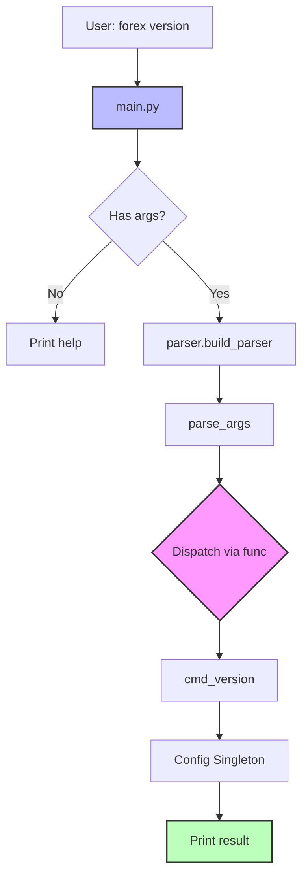

# 📈 Forex Tracker (CLI & Agent Base)

> أداة سطر أوامر (CLI Tool) مفتوحة المصدر مبنية وفق معمارية **Agile / Vertical Slice Architecture** لتحليل أسواق وتداولات العملات الأجنبية (Forex). تمثل الأساس المعماري الصلب لتطوير **Forex Agent** ذكي يعتمد على خوارزميات التعلم الآلي وقابلية التفسير (ML + LSTM + XAI).

---

## 📑 جدول المحتويات

- [مخرجات Sprint 0](#-مخرجات-sprint-0--foundation)
- [متطلبات التشغيل](#️-متطلبات-التشغيل-prerequisites)
- [التثبيت والإعداد](#-التثبيت-والإعداد-installation--setup)
- [الاستخدام وأوامر الـ CLI](#-الاستخدام-وأوامر-الـ-cli-المتاحة)
- [تشغيل اختبارات الوحدة](#-تشغيل-اختبارات-الوحدة-automated-tests)
- [هيكل المشروع](#-هيكل-المشروع-الحالي-project-structure)
- [المعمارية ومبادئ التصميم](#️-المعمارية-ومبادئ-التصميم)
- [خارطة الطريق](#️-خارطة-الطريق-roadmap)

---

## 🚀 مخرجات Sprint 0 — Foundation

تم في هذا الـ Sprint تأسيس البنية التحتية الأساسية والصلبة للمشروع مع تطبيق مبادئ **Clean Code** و **Design Patterns**:

| # | المكوّن | الوصف | النمط المستخدم |
| --- | --------- | ------- | ---------------- |
| 1 | **Config Layer** | تحميل مركزي للإعدادات من `config.json` مع دعم التجاوز عبر متغيرات البيئة | Singleton Pattern |
| 2 | **Custom Exceptions** | شجرة أخطاء معيارية وموحدة ترث من `ForexError` لتسهيل التتبع والمعالجة | Exception Hierarchy |
| 3 | **Logging System** | تسجيل تلقائي في ملف دائم (`logs/app.log`) + عرض على الشاشة | Handler Chain |
| 4 | **Diagnostic Decorators** | ديكوريتور `@timer` لقياس زمن استجابة الدوال | Decorator Pattern |
| 5 | **Storage Abstraction** | واجهة تجريدية عامة للتخزين مع تطبيق مبدئي في الذاكرة | Repository / ABC |
| 6 | **Modular CLI** | واجهة سطر أوامر بـ `argparse` مع ربط الأوامر بالدوال ودعم أمر النظام `forex` | Command / Dispatch |
| 7 | **Automated Testing** | تغطية كاملة للبنية التحتية باستخدام `unittest` القياسية | Test Isolation |

---

## 🛠️ متطلبات التشغيل (Prerequisites)

| المتطلب | الإصدار |
| --------- | --------- |
| **Python** | 3.12+ |
| **نظام التشغيل** | Linux / WSL Ubuntu / macOS / Windows |
| **أدوات إضافية** | `pip`, `venv` (مدمجة في Python 3.12) |

---

## 📦 التثبيت والإعداد (Installation & Setup)

### 1️⃣ استنساخ المستودع

```bash
git clone <repository-url>
cd forex_tracker
```

### 2️⃣ إنشاء وتفعيل البيئة الافتراضية

```bash
# إنشاء البيئة
python3 -m venv venv
```

**تفعيل البيئة:**

| النظام | الأمر |
| -------- | ------- |
| **Linux / macOS / WSL** | `source venv/bin/activate` |
| **Windows (PowerShell)** | `.\venv\Scripts\Activate.ps1` |
| **Windows (CMD)** | `venv\Scripts\activate.bat` |

### 3️⃣ تثبيت الحزمة كأمر طرفي تفاعلي

```bash
pip install -e .
```

> 💡 **ملاحظة**: خيار `-e` (Editable Mode) يتيح تعديل الكود واختباره **فوراً** عبر أمر `forex` دون الحاجة لإعادة التثبيت — مثالي لبيئة التطوير.

---

## 💻 الاستخدام وأوامر الـ CLI المتاحة

بمجرد اكتمال التثبيت، يمكنك استدعاء الأداة مباشرة من أي مكان داخل البيئة الافتراضية:

### 📋 عرض قائمة الأوامر والمساعدة

```bash
forex --help
```

### 🔢 فحص رقم إصدار التطبيق

```bash
forex version
```

**المتوقع:**

```
Forex Tracker v0.1.0
```

### 🔍 التحقق من حالة النظام ومسارات السجلات

```bash
forex status
```

**المتوقع:**

```
--- Forex Tracker Status ---
App: Forex Tracker
Log File: ./logs/app.log
Data Dir: ./data
```

### 🐍 التشغيل المباشر عبر Python

بدلاً من أمر النظام:

```bash
python3 main.py --help
python3 main.py version
python3 main.py status
```

---

## 🧪 تشغيل اختبارات الوحدة (Automated Tests)

للتحقق من سلامة البنية التحتية الأساسية:

```bash
python -m unittest tests/test_foundation.py
```

**النتيجة المتوقعة:**

```
...
----------------------------------------------------------------------
Ran 3 tests in 0.0xxs

OK
```

### 🎯 ما الذي تغطيه الاختبارات؟

| الاختبار | ما يتحقق منه |
| ---------- | --------------- |
| `test_config_singleton_and_values` | تطابق الكائن في الذاكرة + صحة القيم |
| `test_memory_storage_lifecycle` | دورة حياة الاتصال (connect / disconnect) |
| `test_timer_decorator` | سلامة مخرجات الدالة بعد تطبيق الـ Decorator |

---

## 📂 هيكل المشروع الحالي (Project Structure)

```
forex_tracker/
├── config.json              # ملف الإعدادات الأساسي
├── pyproject.toml           # إعدادات الحزمة وربط أمر forex
├── README.md                # توثيق المشروع
├── main.py                  # نقطة الدخول البديلة للتشغيل المباشر
│
├── cli/                     # طبقة سطر الأوامر
│   ├── __init__.py
│   ├── parser.py            # معالجة المدخلات ونقطة تشغيل CLI main()
│   └── commands.py          # دوال تنفيذ الأوامر (version, status)
│
├── core/                    # النواة الأساسية
│   ├── __init__.py
│   ├── config.py            # مدير الإعدادات (Singleton)
│   ├── exceptions.py        # التسلسل الهرمي للأخطاء
│   └── logger.py            # نظام السجلات
│
├── storage/                 # طبقة التخزين المجردة
│   ├── __init__.py
│   ├── base.py              # العقد الأساسي للتخزين (Storage ABC)
│   └── memory_storage.py    # تخزين في الذاكرة للاختبارات
│
├── utils/                   # أدوات مساعدة
│   ├── __init__.py
│   └── decorators.py        # ديكوريتور قياس الأداء (@timer)
│
├── logs/                    # مجلد حفظ سجلات التطبيق
│   └── app.log
│
└── tests/                   # اختبارات الوحدة
    ├── __init__.py
    └── test_foundation.py   # اختبارات Sprint 0
```

---

## 🏗️ المعمارية ومبادئ التصميم

### 🎯 المبادئ الذهبية المطبقة

| المبدأ | التطبيق في المشروع |
| -------- | --------------------- |
| **Single Responsibility** | كل ملف له مسؤولية واحدة واضحة |
| **Open/Closed Principle** | إضافة أمر جديد = سطرين في `parser.py` |
| **Dependency Inversion** | الخدمات تعتمد على `Storage ABC` مش على تطبيق محدد |
| **Separation of Concerns** | Parsing منفصل عن Execution |
| **Fail Fast** | التحقق من وجود الملفات عند الإقلاع |
| **YAGNI** | لا كود زائد، نبني ما نحتاجه فقط |

### 🔄 مخطط تدفق تنفيذ الأمر



### 🗂️ طبقات المشروع

| الطبقة | الدور | الملفات |
| -------- | ------- | --------- |
| **Entry Point** | نقطة البداية | `main.py` |
| **CLI Layer** | تحليل المدخلات وتنفيذ الأوامر | `cli/` |
| **Core Layer** | الإعدادات، السجلات، الأخطاء | `core/` |
| **Storage Layer** | التجريد والتخزين | `storage/` |
| **Utils Layer** | أدوات مساعدة | `utils/` |
| **Tests Layer** | اختبارات الوحدة | `tests/` |

---

## 🗺️ خارطة الطريق (Roadmap)

### ✅ Sprint 0 — Foundation (مكتمل)

- [x] Config Singleton
- [x] Logging System
- [x] Custom Exceptions
- [x] Timer Decorator
- [x] Storage ABC + MemoryStorage
- [x] Modular CLI
- [x] Unit Tests

## 🤝 المساهمة (Contributing)

المساهمات مرحب بها! يُرجى اتباع الخطوات التالية:

1. Fork المشروع
2. إنشاء فرع جديد (`git checkout -b feature/AmazingFeature`)
3. Commit التغييرات (`git commit -m 'Add AmazingFeature'`)
4. Push للفرع (`git push origin feature/AmazingFeature`)
5. فتح Pull Request

---

## 📄 الترخيص (License)

هذا المشروع مفتوح المصدر — راجع ملف `LICENSE` لمزيد من التفاصيل.

---

## 📬 التواصل

لأي استفسارات أو اقتراحات، يُرجى فتح **Issue** في المستودع.

---

<div align="center">

**⭐ إذا أعجبك المشروع، لا تنسَ إعطاءه نجمة! ⭐**

صُنع بـ ❤️ لمجتمع Forex العربي

</div>
