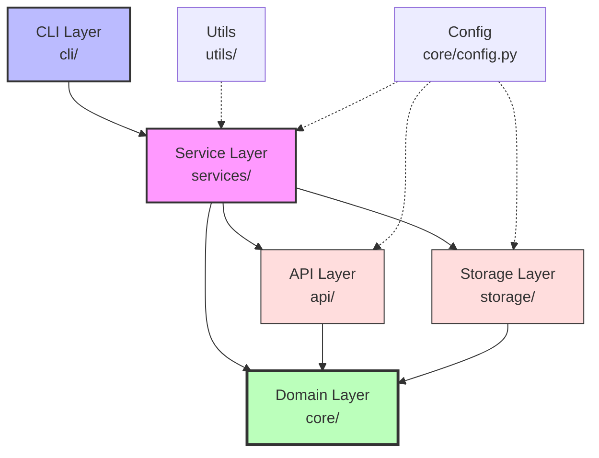

# 📈 Forex Tracker (CLI & Agent Base)

> **أداة سطر أوامر (CLI Tool) مفتوحة المصدر** مبنية وفق معمارية **Agile / Vertical Slice Architecture** لتحليل وتتبع أسواق العملات الأجنبية (Forex). تمثل الأساس المعماري لتطوير **Forex AI Agent** تفاعلي يعتمد على خوارزميات التعلم الآلي وقابلية التفسير (ML + LSTM + XAI).

<div align="center">


</div>

---

## 📑 جدول المحتويات

<details>
<summary>اضغط لعرض المحتويات</summary>

- [نظرة عامة](#-نظرة-عامة)
- [متطلبات التشغيل](#️-متطلبات-التشغيل)
- [التثبيت والإعداد](#-التثبيت-والإعداد)
- [الاستخدام وأوامر الـ CLI](#-الاستخدام-وأوامر-الـ-cli)
- [الاختبارات](#-تشغيل-اختبارات-الوحدة)
- [هيكل المشروع](#-هيكل-المشروع-الحالي)
- [المعمارية ومبادئ التصميم](#️-المعمارية-ومبادئ-التصميم)
- [خارطة الطريق](#️-خارطة-الطريق-roadmap)
- [المساهمة](#-المساهمة)
- [الترخيص](#-الترخيص)

</details>

---

## 🎯 نظرة عامة

**Forex Tracker** ليس مجرد أداة لجلب الأسعار — بل هو **أساس معماري صلب** لبناء وكيل ذكي (AI Agent) قادر على:

- 📊 تحليل الأسواق وتتبع الشموع السعرية بدقة مالية عالية.
- 🤖 استخدام نماذج التعلم الآلي للتنبؤ بالاتجاهات.
- 🔍 تقديم تفسيرات واضحة لقرارات النماذج (Explainable AI).

### ✨ المميزات الأساسية

| الميزة | الوصف |
| -------- | ------- |
| 🏗️ **Clean Architecture** | فصل تام بين الطبقات (Domain / Services / CLI / Storage) |
| 💰 **دقة مالية** | استخدام `Decimal` بدلاً من `float` لتجنب أخطاء التقريب |
| 🔒 **Immutable Objects** | حماية بيانات الشموع من التعديل العرضي |
| 🔌 **Adapter Pattern** | سهولة استبدال مزودي البيانات (TwelveData → أي مصدر آخر) |
| 🧪 **Testable** | Dependency Injection وعزل كامل للاختبارات |
| 📝 **Logging شامل** | تسجيل دائم في ملفات + عرض على الطرفية |

---

## 📚 توثيق الـ Sprints المكتملة

للاطلاع على التفاصيل المعمارية الكاملة لكل Sprint:

| Sprint | الحالة | التوثيق |
|--------|--------|---------|
| **Sprint 0 — Foundation** | ✅ مكتمل | [📄 عرض التوثيق](docs/sprint_0_documentation.md) |
| **Sprint 1 — PRICE (MVP)** | ✅ مكتمل | [📄 عرض التوثيق](docs/sprint_1_documentation.md) |

> 💡 كل ملف توثيق يحتوي على: المكونات، الأنماط المعمارية، مخططات التدفق، وقرارات التصميم.

---

## 🛠️ متطلبات التشغيل

<table>
<tr>
<th>المتطلب</th>
<th>الإصدار</th>
<th>ملاحظات</th>
</tr>
<tr>
<td><b>Python</b></td>
<td>3.12+</td>
<td>مطلوب لدعم Type Hints الحديثة و <code>match</code> statements</td>
</tr>
<tr>
<td><b>نظام التشغيل</b></td>
<td>Linux / WSL Ubuntu / macOS / Windows</td>
<td>جميع الأنظمة مدعومة</td>
</tr>
<tr>
<td><b>أدوات إضافية</b></td>
<td><code>pip</code>, <code>venv</code></td>
<td>مدمجة مع Python 3.12</td>
</tr>
</table>

---

## 📦 التثبيت والإعداد

### 1️⃣ استنساخ المستودع

```bash
git clone <repository-url>
cd forex_tracker
```

### 2️⃣ إنشاء وتفعيل البيئة الافتراضية

**إنشاء البيئة:**

```bash
python3 -m venv venv
```

**تفعيل البيئة حسب نظام التشغيل:**

| النظام | الأمر |
| -------- | ------- |
| **Linux / macOS / WSL** | `source venv/bin/activate` |
| **Windows (PowerShell)** | `.\venv\Scripts\Activate.ps1` |
| **Windows (CMD)** | `venv\Scripts\activate.bat` |

### 3️⃣ تثبيت الحزمة

```bash
pip install -e .
```

> 💡 **ملاحظة**: خيار `-e` (Editable Mode) يتيح تعديل الكود واختباره **فوراً** عبر أمر `forex` دون الحاجة لإعادة التثبيت.

---

## 💻 الاستخدام وأوامر الـ CLI

بمجرد اكتمال التثبيت وتفعيل البيئة الافتراضية:

### 📋 عرض قائمة المساعدة

```bash
forex --help
```

### 💵 جلب السعر اللحظي الفوري

```bash
forex price --pair EUR/USD
```

**المخرجات المتوقعة:**

```
EUR/USD: 1.0842 (2026-10-10 14:30:00)
```

### 📥 جلب الشموع وتخزينها في قاعدة البيانات

```bash
forex fetch --pair EUR/USD --limit 5
```

**المخرجات المتوقعة:**

```
✓ Fetched 5 candles for EUR/USD
✓ Saved to data/candles.db
```

### 📊 استعراض آخر الشموع المخزنة

```bash
forex list --pair EUR/USD --limit 10
```

**المخرجات المتوقعة:**

```
┌────────────┬──────────┬──────────┬──────────┬──────────┬────────┐
│ Timestamp  │ Open     │ High     │ Low      │ Close    │ Volume │
├────────────┼──────────┼──────────┼──────────┼──────────┼────────┤
│ 2026-10-10 │ 1.0817   │ 1.0865   │ 1.0803   │ 1.0842   │ 125432 │
└────────────┴──────────┴──────────┴──────────┴──────────┴────────┘
```

### 🔍 فحص حالة النظام

```bash
forex status
```

**المخرجات المتوقعة:**

```
--- Forex Tracker Status ---
App: Forex Tracker
Log File: ./logs/app.log
Data Dir: ./data
DB: ./data/candles.db
```

---

## 🧪 تشغيل اختبارات الوحدة

لتشغيل حزمة الاختبارات الشاملة:

```bash
python -m unittest discover tests
```

**النتيجة المتوقعة:**

```
....................
----------------------------------------------------------------------
Ran 20 tests in 0.123s

OK
```

### 🎯 ما الذي تغطيه الاختبارات؟

| الملف | التغطية |
|-------|---------|
| `test_foundation.py` | Config Singleton + Storage + Timer Decorator |
| `test_price_mvp.py` | Candle Validation + HTTP Client + TwelveData Adapter + SQLite CRUD |

---

## 📂 هيكل المشروع الحالي

```
forex_tracker/
│
├── config.json              # ملف الإعدادات الأساسي
├── pyproject.toml           # إعدادات الحزمة وربط أمر forex
├── README.md                # توثيق المشروع
├── main.py                  # نقطة الدخول البديلة للتشغيل المباشر
│
├── api/                     # طبقة الاتصال الخارجي والشبكة
│   ├── __init__.py
│   ├── client.py            # عميل HTTP الموحد ومعالجة الـ Timeout
│   └── sources/             # محولات مصادر البيانات (Adapters)
│       ├── __init__.py
│       └── twelvedata.py    # محول واجهة TwelveData API
│
├── cli/                     # طبقة سطر الأوامر
│   ├── __init__.py
│   ├── parser.py            # معالجة المدخلات ونقطة تشغيل CLI
│   └── commands.py          # دوال تنفيذ الأوامر (price, fetch, list...)
│
├── core/                    # النواة الأساسية ومنطق الـ Domain
│   ├── __init__.py
│   ├── candle.py            # نموذج الشمعة السعرية (Immutable Value Object)
│   ├── pair.py              # كائن التحقق وتوحيد أزواج العملات
│   ├── intervals.py         # الأطر الزمنية القياسية (Enum)
│   ├── config.py            # مدير الإعدادات (Singleton)
│   ├── exceptions.py        # التسلسل الهرمي للأخطاء
│   └── logger.py            # نظام السجلات
│
├── docs/                    # توثيق مراحل التطوير
│   ├── sprint_0_documentation.md
│   └── sprint_1_documentation.md
│
├── services/                # طبقة تنسيق الأعمال (Business Logic)
│   ├── __init__.py
│   └── forex_service.py     # منسق العمليات بين الـ API والتخزين
│
├── storage/                 # طبقة التخزين الدائم
│   ├── __init__.py
│   ├── base.py              # العقد الأساسي للتخزين (Storage ABC)
│   ├── memory_storage.py    # تخزين في الذاكرة للاختبارات
│   └── sqlite_storage.py    # محرك التخزين الدائم بـ SQLite
│
├── utils/                   # أدوات مساعدة
│   ├── __init__.py
│   └── decorators.py        # ديكوريتور قياس الأداء (@timer)
│
├── data/                    # مجلد قاعدة البيانات المحلية
│   └── candles.db
├── logs/                    # مجلد سجلات التطبيق
│   └── app.log
└── tests/                   # اختبارات الوحدة المؤتمتة
    ├── __init__.py
    ├── test_foundation.py   # اختبارات Sprint 0
    └── test_price_mvp.py    # اختبارات Sprint 1
```

### 🗂️ الطبقات المعمارية



---

## 🏗️ المعمارية ومبادئ التصميم

<table>
<tr>
<th width="25%">المبدأ</th>
<th width="75%">التطبيق في المشروع</th>
</tr>
<tr>
<td><b>Clean Architecture</b></td>
<td>فصل طبقات النواة (Domain) والخدمات (Services) عن واجهات الـ CLI وقواعد البيانات.</td>
</tr>
<tr>
<td><b>Immutable Value Objects</b></td>
<td>حماية بيانات الشموع من التعديل العرضي وحسابات دقيقة بـ <code>Decimal</code>.</td>
</tr>
<tr>
<td><b>Adapter Pattern</b></td>
<td>فصل كود مزودي الأسعار الخارجيين عن باقي أجزاء التطبيق لتسهيل استبدالهم لاحقاً.</td>
</tr>
<tr>
<td><b>Dependency Injection</b></td>
<td>تمرير مصادر البيانات ومحركات التخزين للخدمات لتسهيل عزل الاختبارات ومحاكاتها.</td>
</tr>
<tr>
<td><b>YAGNI & Fail Fast</b></td>
<td>بناء ما نحتاجه فقط في كل Sprint مع التحقق الصارم من صحة المدخلات قبل معالجتها.</td>
</tr>
</table>

---

## 🗺️ خارطة الطريق (Roadmap)

### ✅ المكتمل

- [x] **Sprint 0**: Foundation — التأسيس، الإعدادات، السجلات، والأوامر الأساسية → [📄 التوثيق](docs/sprint_0_documentation.md)
- [x] **Sprint 1**: PRICE (MVP) — نموذج الشمعة، عميل HTTP، محول TwelveData، وقاعدة SQLite → [📄 التوثيق](docs/sprint_1_documentation.md)

### 🚧 قيد التنفيذ

- [ ] **Sprint 2**: Multi-Pairs & Historical Data — دعم أزواج متعددة، الأطر الزمنية، والحفظ الجماعي السريع (Bulk)

### 🔮 قادم

- [ ] **Sprint 3**: Technical Indicators Engine — محرك المؤشرات الفنية (SMA, EMA, RSI, MACD)
- [ ] **Sprint 4**: Alerts & Triggers — نظام التنبيهات السعرية والفنية
- [ ] **Sprint 5**: Caching & Performance — التخزين المؤقت عبر Redis وتقليل استهلاك الحصة
- [ ] **Sprint 6**: Strategy Backtesting — محاكي اختبار استراتيجيات التداول التاريخية
- [ ] **Sprint 7**: Risk Management — حاسبة إدارة المخاطر وأحجام العقود
- [ ] **Sprint 8**: Machine Learning (Forecasting) — نماذج التنبؤ باتجاه الأسعار
- [ ] **Sprint 9**: Explainable AI (XAI) — طبقة تفسير قرارات النماذج الذكية
- [ ] **Sprint 10**: Docker & Background Tasks — حاويات النشر وجدولة المهام الآلية
- [ ] **Sprint 11**: Forex AI Agent — وكيل ذكي تفاعلي لتحليل الأسواق
- [ ] **Sprint 12**: Packaging & Final Release — توثيق معماري نهائي ونشر الحزمة

---

## 🤝 المساهمة

نرحب بمساهماتكم! يُرجى اتباع الخطوات التالية:

1. **Fork** المشروع
2. إنشاء فرع جديد (`git checkout -b feature/AmazingFeature`)
3. **Commit** التغييرات (`git commit -m 'feat: add AmazingFeature'`)
4. **Push** للفرع (`git push origin feature/AmazingFeature`)
5. فتح **Pull Request**

### 📝 نمط رسائل Commit

نستخدم [Conventional Commits](https://www.conventionalcommits.org/):

| النوع | الاستخدام |
| ------- | ----------- |
| `feat` | ميزة جديدة |
| `fix` | إصلاح خطأ |
| `docs` | تحديث التوثيق |
| `test` | إضافة/تعديل اختبارات |
| `refactor` | إعادة هيكلة بدون تغيير السلوك |
| `chore` | مهام روتينية (deps, config) |

---

## 📄 الترخيص

هذا المشروع مرخص تحت رخصة **MIT**. راجع ملف [LICENSE](LICENSE) لمزيد من التفاصيل.

---

<div align="center">

### ⭐ إذا أعجبك المشروع، لا تنسَ إعطاءه نجمة! ⭐

**صُنع بـ ❤️ لمجتمع Forex العربي**

[⬆ العودة للأعلى](#-forex-tracker-cli--agent-base)

</div>
